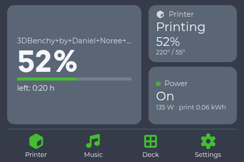
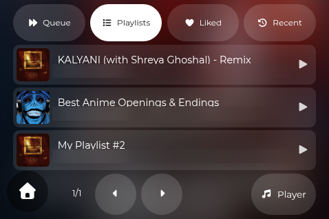
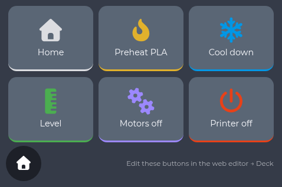
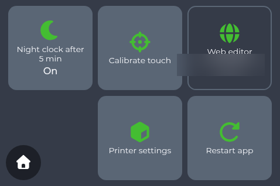
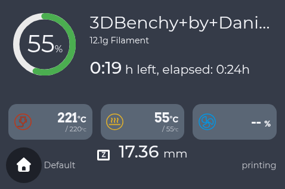
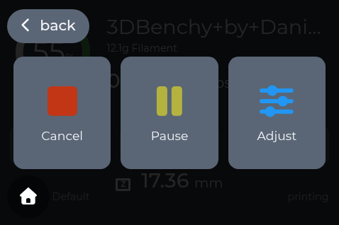
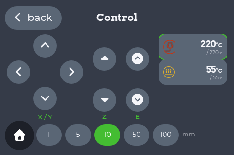
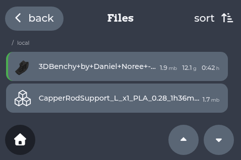
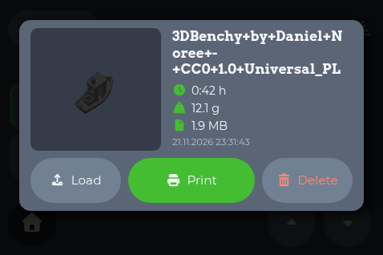
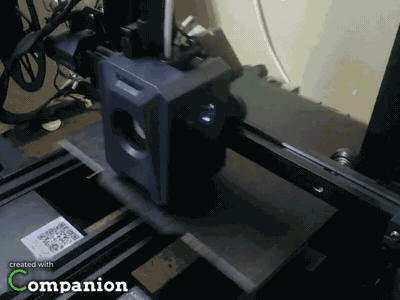

# Companion

**A CarPlay-style home screen for your 3D printer's touchscreen.**

## Why

A printer touchscreen (OctoDash, the printer's own display) only does something while you print. The rest of the time it sits there showing an error or a sleeping logo. And even while printing, most of the time there's nothing to do on it.

So I made it do something. Companion turns that little screen next to the printer into a companion: a clock and weather, your music, your power plug, your own shortcut buttons. The printer controls (OctoDash) are still there, as one app among others.

## Screenshots

All taken on the real 3.5" screen (480×320) during a print.

|                                                                                                                                   |                                                                                                                               |
| --------------------------------------------------------------------------------------------------------------------------------- | ----------------------------------------------------------------------------------------------------------------------------- |
|  **Boot:** the gear turns into the "C"                                             |  **Dashboard:** print progress, live watts and kWh of the print |
|  **Music:** Spotify remote, album cover as live poster                                     |  **Library:** queue, playlists, liked, recent (names blurred)          |
|  **Deck:** your own shortcut buttons                                                         |  **Settings:** night clock, touch calibration, web editor                        |
|  **Printer:** OctoDash, restyled                                        |  **Print controls:** cancel, pause, adjust                           |
|  **Control:** jog X/Y/Z/E, step sizes, temperatures                                    |  **Files:** slicer thumbnails, ▲ ▼ instead of swiping                                  |
|  **File details:** Load, Print (works with the printer off), Delete (2 taps) |                                                                                                                               |

## Timelapse

A Benchy printed with Companion on the screen, with the Companion watermark ([full video](docs/timelapse-benchy.mp4)):

## What it does

On a 3.5" touchscreen (480×320), tap-only. No swipes; pages turn with ◀ ▶ buttons so it works reliably on cheap resistive touch.

- **Boot animation:** a gear that turns into the "C" of Companion.
- **Dashboard:**
  - Clock, date and weather.
  - While printing: progress, time left and temperatures.
  - While music plays: the album cover fills the widget.
  - Printer and power cards (live watts and kWh per print from a TP-Link Tapo P110).
- **Printer:** the full OctoDash (files with slicer thumbnails, control, filament, print controls), restyled to match.
  - **Print with the printer off:** pick a file, tap Print. The plug switches on, OctoPrint connects, the print starts.
  - **Cancel parks the head:** X/Y home, Z stays put.
- **Music:** Spotify remote with a blurred "live poster" background, synced lyrics (LRCLIB), queue, playlists, liked and recent songs.
- **Deck:** your own shortcut buttons (G-code, plug on/off, HTTP calls such as Home Assistant webhooks). Risky ones need two taps.
- **Night clock:** after 5 minutes without a tap, a black flip clock with the date. The first tap only wakes the screen.
- **Timelapse watermark:** "created with Companion" instead of "created with OctoPrint", via the [Timelapse Watermark](https://github.com/sudo-atharva/OctoPrint-TimelapseWatermark) plugin ([logo](docs/companion-watermark.png)).
- **Touch calibration** on first start, built in (no xinput_calibrator).
- **Web editor** at `http://<octopi>/plugin/companion/` (needs the Companion OctoPrint plugin):
  - Live preview of the screen.
  - Dashboard, Deck, screen and OctoDash settings.
  - Spotify login and Tapo plug setup.
  - Over Tailscale it's the same address from anywhere, with HTTPS.

## Setup

See **[SETUP.md](SETUP.md)**: build, Pi install script (incl. 3.5" SPI screen), OctoPrint plugin, power plug, Tailscale, Spotify, thumbnails.

## Parts

| Part                                                                                   | What                                                                                                 |
| -------------------------------------------------------------------------------------- | ---------------------------------------------------------------------------------------------------- |
| this repo                                                                              | the screen app (Electron + Angular, a fork of [OctoDash](https://github.com/UnchartedBull/OctoDash)) |
| Companion OctoPrint plugin                                                             | serves the web editor, stores the screen's config, Spotify login, print-with-printer-off             |
| [OctoPrint-PSUControl-Tapo](https://github.com/sudo-atharva/OctoPrint-PSUControl-Tapo) | Tapo P110 power plug: on/off, auto-connect, auto-off, energy readings                                |
| Slicer Thumbnails (jneilliii)                                                          | G-code thumbnails in the file list                                                                   |

## Hardware it's tested on

- Raspberry Pi 3B+, Raspberry Pi OS 12 (bookworm, 32-bit, OctoPi)
- Generic 3.5" SPI touchscreen (ILI9486 + XPT2046). Use goodtft LCD-show's `tft35a` overlay; the stock `piscreen`/`ads7846` overlays declare the pen-down pin active-high, and current kernels then drop every touch.
- TP-Link Tapo P110

## Credits

Companion is built on [OctoDash](https://github.com/UnchartedBull/OctoDash) by UnchartedBull and contributors (Apache 2.0, see `LICENSE.md`). The original README is in [README.octodash.md](README.octodash.md).
